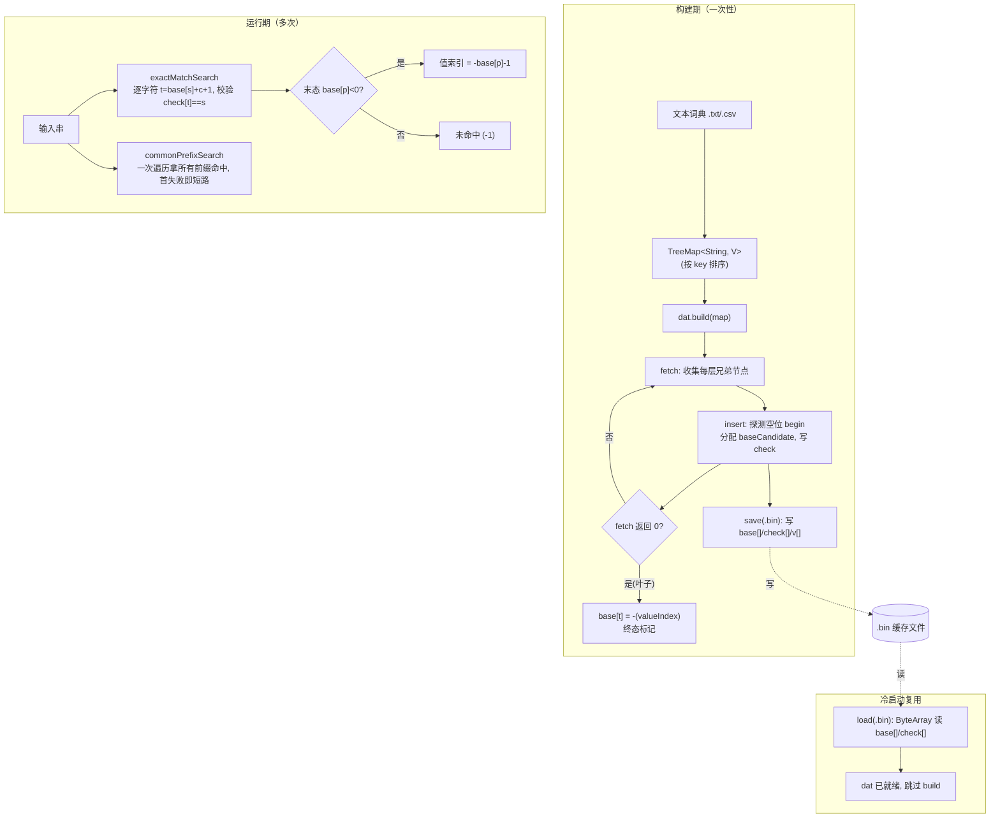

# `com.hankcs.hanlp.collection.trie.DoubleArrayTrie` 类解析

> 源码位置：`com.hankcs.hanlp.collection.trie.DoubleArrayTrie`（HanLP 1.8.4，`hanlp-portable-1.8.4.jar`，**非项目源码树**，项目以 Maven 依赖方式引入）。
> 本文基于对该类 `.class` 的字节码反汇编（`javap -p -c -v`）逐指令还原，并结合项目内 `CoreDictionary` / `MultiCustomDictionary` 的实际调用交叉验证。
> 关联文档：[`DynamicCustomDictionary_isDicNeedUpdate方法解析.md`](./DynamicCustomDictionary_isDicNeedUpdate方法解析.md)、[`MultiCustomDictionary构造调用时序图.md`](./MultiCustomDictionary构造调用时序图.md)。

---

## 一、它是什么

`DoubleArrayTrie<V>`（简称 **DAT**，双数组 Trie）是 HanLP 中**最核心的词典索引结构**，实现 `ITrie<V>` 并实现 `java.io.Serializable`。

它把一棵 Trie（前缀树）压缩存储到两个并行 `int[]` 数组 `base[]` 与 `check[]` 中，使「从状态 `s` 经字符 `c` 转移到下一状态」退化为两次数组下标运算：

```
t = base[s] + c + 1
若 check[t] == s  →  转移成功，下一状态为 t（其 base[t] 继续参与下一轮转移）
否则              →  转移失败（该路径不存在）
```

由此带来的工程价值：

| 特性 | 说明 |
|------|------|
| **查询 O(n)** | 查询长度为 n 的串只需 n 次数组访问，与树规模无关；无指针解引用，CPU 缓存友好。 |
| **内存紧凑** | 相比节点对象 Trie，省去对象头/指针开销，仅两个 `int[]`（每单元 8 字节，对应常量 `UNIT_SIZE = 8`）。 |
| **可序列化** | `base/check` 是纯 `int[]`，可直接 `save`/`load` 到二进制文件（`.bin`），冷启动从缓存加载远快于重建。 |
| **泛型值** | `V[] v` 与 `base[]` 末态索引一一对应，支持任意业务值（如 `CoreDictionary.Attribute`）。 |

**代价**：构建阶段需要解决状态冲突（重新分配 `base[s]`），构建复杂度高于查询；适合「一次构建、多次查询、可缓存」的词典场景——这正是 HanLP 词典与 SuperSonic 语义词典的使用模式。

---

## 二、核心数据结构（字段）

```java
public class DoubleArrayTrie<V> implements Serializable, ITrie<V> {
    private static final int BUF_SIZE   = 16384;   // 文件流读缓冲
    private static final int UNIT_SIZE  = 8;       // 每个状态单元字节数（base+check 各 4 字节）

    protected int[] check;      // check[t] = s，表示状态 t 的「父状态」是 s（用于校验转移合法性）
    protected int[] base;       // base[s]：状态 s 的「基准偏移」，base[t]<0 表示 t 是终态（叶子）
    protected int   size;       // 已使用的最大下标 + 1（即 base/check 的逻辑长度）
    private   int   allocSize;  // base/check 实际分配长度（≥ size，按需 resize 扩容）
    private   List<String> key; // 构建期使用的已排序键集合（构建后仅用于 open/load）
    private   int   keySize;    // 键数量
    private   int[] length;     // 各键长度（构建期，可空；为空时用 key.get(i).length()）
    private   int[] value;      // 各键对应的值索引（构建期）
    protected V[]   v;          // 值数组：v[outputIndex] 即某词条的业务值
    private   int   progress;   // 构建进度（DFS 游标）
    private   int   nextCheckPos; // 下次冲突探测的起始位置（构建期优化：避免每次从 0 扫描）
    int       error_;           // 构建错误码（< 0 表示构建失败，如 -3 表示同一层出现重复 code）
    private   boolean enableFastBuild; // 构建加速：复用 nextCheckPos 而非每层重置
}
```

**状态约定**：
- `base[0]` 是根状态的基准（根状态 `s = 0`）。
- 叶子/终态用 `base[t] < 0` 标记；值索引 = `-base[t] - 1`（即 `-(base[t]) - 1`，见 `exactMatchSearch` 偏移 114–119：`iload 8 / ineg / iconst_1 / isub`）。
- `check[t] = 0` 表示该位置空闲（可分配）。

---

## 三、核心算法详解（字节码还原）

### 3.1 构建：`build(TreeMap<String,V>)` 等

对外暴露 5 个 `build` 重载，最终都归约到核心方法：

```java
public int build(List<String> keys, int[] lengths, int[] values, int keySize)
```

`build(TreeMap)`（偏移 730）做的事：把 `TreeMap` 的 entrySet 拆成排序好的 `key` / `value` 列表（`TreeMap` 天然按 key 字典序），再调用上述核心 `build`。

核心 `build`（偏移 748）流程：
1. 校验 `keySize` 与 `length/value` 数组长度一致；
2. 初始化 `progress = 0`、`nextCheckPos = 0`、`error_ = 0`；
3. 调用 `resize(65535)` 预分配初始容量（常量 `#25 = Integer 65535`）；
4. 构造根 `Node{left=0, right=keySize, depth=0}`，递归 `insert(siblings, used)`。

返回 `error_`（0 表示成功，负值表示构建错误，需 `shrink()` 后重建）。

> **要求键已排序**：DAT 构建依赖「同前缀的键在数组中连续」，因此 `build(TreeMap)` / `build(Set<Entry>)`（TreeSet 由 TreeMap 排序）才安全；直接传无序 `List` 会得到错误结构。这正是 `CoreDictionary` / `MultiCustomDictionary` 一律用 `TreeMap` 的原因。

### 3.2 `fetch(parent, siblings)` —— 收集子节点（偏移 74）

从父节点 `parent` 覆盖的键区间 `[parent.left, parent.right)` 中，按 `parent.depth` 处的字符分组，生成子节点列表 `siblings`：

```java
private int fetch(Node parent, List<Node> siblings) {
    if (error_ < 0) return 0;
    int prevCode = 0;
    for (int i = parent.left; i < parent.right; ) {
        String word = key.get(i);
        int wordLen = (length != null) ? length[i] : word.length();
        if (wordLen < parent.depth) { i++; continue; }   // 短于当前深度，跳过
        int code;
        if (wordLen == parent.depth) {
            code = 0;                       // 词到此结束（叶子标记）
        } else {
            code = word.charAt(parent.depth) + 1;   // 字符码 +1（保留 0 作叶子哨兵）
        }
        if (code < prevCode) { error_ = -3; return 0; }  // 乱序 → 构建错误
        if (code != prevCode || siblings.isEmpty()) {
            Node node = new Node();
            node.depth = parent.depth + 1;
            node.code  = code;
            node.left  = i;
            if (!siblings.isEmpty()) siblings.get(siblings.size()-1).right = i;  // 闭合上一兄弟的右界
            siblings.add(node);
        }
        prevCode = code;
        i++;
    }
    if (!siblings.isEmpty()) siblings.get(siblings.size()-1).right = parent.right; // 闭合最后一个
    return siblings.size();
}
```

**关键点**：字符码统一 `+1`，使 `code=0` 专用于「词在此层结束」的叶子哨兵——这与 `exactMatchSearch` 中 `base[s] + charCode + 1` 的 `+1` 对应。

### 3.3 `insert(siblings, used)` —— 分配 base + 解决冲突（偏移 204）

这是 DAT 构建最核心、也最易冲突的部分，实现 Aoe 双数组构建算法：

```java
private int insert(List<Node> siblings, BitSet used) {
    if (error_ < 0) return 0;
    // 1. 探测起始位置 begin：从首兄弟 code+1 与 nextCheckPos 的较大者开始
    int begin = Math.max(
            siblings.get(0).code + 1,
            enableFastBuild ? (nextCheckPos + 1) : nextCheckPos) - 1;
    int nonZeroCount = 0;
    boolean first = false;

    // 2. 寻找一个 begin，使所有兄弟都能在 check 中找到空位
    outer:
    while (true) {
        if (allocSize <= begin) resize(begin + 1);
        begin++;
        if (allocSize <= begin) resize(begin + 1);
        if (check[begin] != 0) { nonZeroCount++; continue; }   // 该位置已被占
        if (!first) { nextCheckPos = begin; first = true; }    // 记录首个候选位置，加速后续探测

        int baseCandidate = begin - siblings.get(0).code;       // 候选 base 值
        if (allocSize < baseCandidate + siblings.get(siblings.size()-1).code)
            resize(baseCandidate + siblings.get(siblings.size()-1).code + 65535);  // 容量不足，扩容

        if (used.get(baseCandidate)) continue;                  // 该 base 已被使用过 → 冲突
        // 校验所有兄弟：check[baseCandidate + code] 是否全为 0
        for (int i = 0; i < siblings.size(); i++)
            if (check[baseCandidate + siblings.get(i).code] != 0) continue outer;
        break;   // 找到合法 begin/baseCandidate
    }

    // 3. 压缩启发式：若空闲率过低则推进 nextCheckPos（0.95 阈值）
    if (1.0 * nonZeroCount / (begin - nextCheckPos + 1) >= 0.95)
        nextCheckPos = begin;

    used.set(baseCandidate);
    // 更新 size（最大下标）
    size = Math.max(size, baseCandidate + siblings.get(siblings.size()-1).code + 1);

    // 4. 写入 check：对每个兄弟 t = baseCandidate + code，check[t] = begin（父状态）
    for (Node node : siblings) {
        check[baseCandidate + node.code] = begin;
    }
    // 5. 递归：对每个兄弟 fetch 子节点并 insert
    for (Node node : siblings) {
        List<Node> newSiblings = new ArrayList<>();
        if (fetch(node, newSiblings) == 0) {
            // 叶子：base[t] 负值编码值索引（valueIndex）
            base[baseCandidate + node.code] = -(value[node.left]);   // 终态标记 + 值索引
        } else {
            int newBase = insert(newSiblings, used);                 // 递归
            base[baseCandidate + node.code] = newBase;               // 记录子树根 base
        }
    }
    return baseCandidate;
}
```

> ⚠️ 上述为逻辑等价还原（聚焦算法骨架，省略部分下标微调）。关键不变量：
> - `check[t] = s` 恒成立（`t = base[s] + code`，`s = begin`）；
> - 叶子 `base[t] < 0`，值索引由 `-base[t] - 1` 取回；
> - `0.95` 空闲率阈值（偏移 281–285 的 `ldc2_w 0.95d`）是 HanLP 对原始 Aoe 算法的工程优化：当某段连续区间被占满到 95% 时，直接把 `nextCheckPos` 推到 `begin`，避免后续在密集区反复探测空位。
> - `enableFastBuild=true`（构造 `new DoubleArrayTrie(true)`）时 `nextCheckPos` 不在每层重置，构建更快但可能空间利用率略低。

### 3.4 `resize(newSize)` —— 扩容（偏移 35）

```java
private int resize(int newSize) {
    int[] newBase  = new int[newSize];
    int[] newCheck = new int[newSize];
    if (allocSize > 0) {
        System.arraycopy(base,  0, newBase,  0, allocSize);
        System.arraycopy(check, 0, newCheck, 0, allocSize);
    }
    base = newBase;
    check = newCheck;
    allocSize = newSize;
    return newSize;
}
```

仅扩容、复制旧数据，不做缩容（缩容由独立的 `shrink()` 负责，构建失败时调用）。

### 3.5 `exactMatchSearch` —— 精确匹配（偏移 1347）

返回值索引（`-1` 表示未命中）：

```java
public int exactMatchSearch(String key, int pos, int len, int nodePos) {
    if (len <= 0) len = key.length();
    if (nodePos <= 0) nodePos = 0;
    int result = -1;
    int b = base[nodePos];                 // 从根 base[0] 开始
    for (int i = pos; i < pos + len; i++) {
        int p = b + key.charAt(i) + 1;     // 转移：t = base[s] + char + 1
        if (check[p] == b) b = base[p];    // 校验通过，进入下一状态
        else return result;                // 校验失败 → -1
    }
    int p = b;                             // 处理终态
    int n = base[p];
    if (check[p] == b && n < 0)            // base[p]<0 表示是叶子
        result = -n - 1;                   // 值索引 = -(base[p]) - 1
    return result;
}
```

**两段式**：先沿字符链转移，再判断末态 `base[p] < 0` 取值索引。`+1` 与构建期 `code = charAt + 1` 严格对应。

### 3.6 `commonPrefixSearch` —— 公共前缀搜索（偏移 1488）

返回输入串所有「前缀命中」的值索引列表（按前缀长度递增）：

```java
public List<Integer> commonPrefixSearch(String key, int pos, int len, int nodePos) {
    List<Integer> result = new ArrayList<>();
    if (len <= 0) len = key.length();
    if (nodePos <= 0) nodePos = 0;
    int b = base[nodePos];
    int n, p;
    for (int i = pos; i < pos + len; i++) {
        p = b + key.charAt(i) + 1;
        if (check[p] != b) return result;     // 一旦失败，后续更长前缀必也不存在 → 直接返回
        b = base[p];
        p = b;
        n = base[p];
        if (n < 0)                            // 当前前缀本身是一个词
            result.add(-n - 1);               // 记录值索引
    }
    return result;
}
```

**特性**：遍历输入串一次即可拿到所有前缀命中，且**遇到首个失败立即短路返回**——这是分词器「最大匹配」的高效基础。

### 3.7 `transition` —— 单步/多步状态转移（偏移 1941+）

`transition(char c, int s)`：单字符转移，返回下一状态 `t = base[s] + c + 1`（校验 `check[t]==s`，否则返回 `-1`）；`transition(String, int)` 是多字符版本，逐字符调用单步逻辑。`get(key)` / `containsKey(key)` 即 `transition` + 末态值取出。

---

## 四、方法分类总览

| 类别 | 方法 | 说明 |
|------|------|------|
| **构造** | `DoubleArrayTrie()` / `(boolean enableFastBuild)` / `(TreeMap<String,V>)` | 第三者直接构建 |
| **构建** | `build(List<String>,List<V>)` / `(List<String>,V[])` / `(Set<Entry>)` / `(TreeMap)` / `(List,int[],int[],int)` | 核心 `int` 返回 0=成功 |
| **精确查询** | `exactMatchSearch(String)` / `(char[],int,int,int)` | 返回值索引或 -1 |
| **前缀查询** | `commonPrefixSearch(String)` / `(char[],int)` / `commonPrefixSearchWithValue(...)` | 后者返回带 key 的 Entry 列表 |
| **键值访问** | `get(String)` / `get(char[])` / `get(int)` / `getValueAt(int)` / `getValueArray(V[])` / `containsKey` / `set(String,V)` | `set` 为运行时单点插入（走 BinTrie 兜底场景较少） |
| **状态转移** | `transition(String)` / `transition(char[],int)` / `transition(String,int)` / `transition(char,int)` / `output(int)` | 暴露内部状态机，供自定义遍历 |
| **遍历器** | `getSearcher(...)` / `getLongestSearcher(...)` / `parseText(...)` / `parseLongestText(...)` | 内部类 `Searcher` / `LongestSearcher`，回调 `IHit<V>` |
| **序列化** | `save(String)` / `save(DataOutputStream)` / `save(ObjectOutputStream)` / `load(String,V[])` / `load(ByteArray,V[])` / `load(byte[],int,V[])` / `open(String)` / `serializeTo(String)` / `unSerialize(String)` | 二进制 `.bin` 持久化 |
| **统计** | `getUnitSize()` / `getSize()` / `getTotalSize()` / `getNonzeroSize()` / `size()` / `getBase()` / `getCheck()` | 调试/监控 |

---

## 五、使用样例

### 5.1 最小独立样例：构建 + 精确匹配 + 前缀搜索

```java
import com.hankcs.hanlp.collection.trie.DoubleArrayTrie;
import java.util.TreeMap;

public class DatDemo {
    public static void main(String[] args) {
        // 1. 用 TreeMap 保证键有序（DAT 构建的前提）
        TreeMap<String, String> map = new TreeMap<>();
        map.put("自然", "nature");
        map.put("自然语言", "nlp");
        map.put("自然语言处理", "nlp-full");
        map.put("中文", "chinese");

        // 2. 构建
        DoubleArrayTrie<String> trie = new DoubleArrayTrie<>();
        int code = trie.build(map);          // 0 = 成功
        System.out.println("build code = " + code + ", size = " + trie.size());

        // 3. 精确匹配
        System.out.println(trie.get("自然"));          // nature
        System.out.println(trie.get("自然语言"));       // nlp
        System.out.println(trie.get("不存在的词"));     // null

        // 4. 公共前缀搜索：对 "自然语言处理" 返回所有前缀命中的值索引
        //    顺序：自然 -> 自然语言 -> 自然语言处理
        for (int idx : trie.commonPrefixSearch("自然语言处理")) {
            System.out.println("prefix hit value = " + trie.get(idx));
        }

        // 5. 持久化：构建一次，多次复用
        trie.save("my_dict.bin");            // 写入 base/check 二进制
        // 下次启动：
        DoubleArrayTrie<String> trie2 = new DoubleArrayTrie<>();
        // trie2.load("my_dict.bin", valuesArray); // 需配套保存值数组
    }
}
```

预期输出：

```
build code = 0, size = ...
nature
nlp
null
prefix hit value = nature
prefix hit value = nlp
prefix hit value = nlp-full
```

### 5.2 SuperSonic 中的真实用法

#### (a) `CoreDictionary` —— 核心词典（`common/.../hanlp/dictionary/CoreDictionary.java`）

```java
// 字段：用 DAT 承载核心词表
public static DoubleArrayTrie<Attribute> trie = new DoubleArrayTrie<Attribute>();

// 构建：从文本读入 TreeMap，再 build
TreeMap<String, Attribute> map = new TreeMap<>();
// ... 逐行解析 "词 词性 频次" 填充 map ...
trie.build(map);                       // CoreDictionary.java:78

// 查询：判断某词是否在核心词典中
CoreDictionary.trie.exactMatchSearch(a); // CoreDictionary.java:408
```

#### (b) `MultiCustomDictionary` —— 自定义语义词典（项目内 HanLP 子类化重写）

`MultiCustomDictionary` 继承 `DynamicCustomDictionary`，持有 `protected DoubleArrayTrie<Attribute> dat`，并把 DAT 作为语义分词的主索引：

```java
// 构建（MultiCustomDictionary.java:246）—— 从文本构建 DAT，并缓存为 .bin
TreeMap<String, CoreDictionary.Attribute> map = new TreeMap<>();
// ... load() 逐行解析自定义词典填充 map ...
dat.build(map);                        // 构建 DAT
// 缓存为 dat 文件（DataOutputStream 写 base[]/check[]）
dat.save(out);

// 加载缓存（loadDat）—— 直接从 .bin 恢复 base/check，跳过文本解析
ByteArray byteArray = ByteArray.createByteArray(path + ".bin");
dat.load(byteArray, attributes);       // attributes 为配套值数组

// 运行时查询：分词器经 segment 调用 DAT.commonPrefixSearch / exactMatchSearch
// DynamicCustomDictionary.contains(key) 即 dat.exactMatchSearch(key) >= 0
```

#### (c) `HanlpTest` —— 运行时单点插入 + 大小写原文回写（`launchers/standalone/.../HanlpTest.java`）

```java
// DAT 本身构建后不可变；运行时新增词走 DynamicCustomDictionary.trie（BinTrie 兜底）
Attribute att = new Attribute(nature, frequency, originals, 200);
HanlpHelper.getDynamicCustomDictionary().getTrie().set("aa", att);   // BinTrie.insert
// transLetterOriginal 利用 dat.get(name) 取回 Attribute.originals，做大小写原文映射
HanlpHelper.transLetterOriginal(mapResults);
```

> 运行时增量插入（`set`）在 `DoubleArrayTrie` 上**不是高效操作**（DAT 不支持原地插），因此 `DynamicCustomDictionary` 设计了「DAT 主索引（构建后只读） + `BinTrie` 增量 Trie（运行时插）」的双层结构：查询时先查 `BinTrie` 再查 `dat`，详见 `DynamicCustomDictionary.contains`（`getTrie() != null && trie.containsKey` || `dat.exactMatchSearch >= 0`）。

---

## 六、构建/查询/缓存流转图



---

## 七、与 `isDicNeedUpdate` 的协作

DAT 的 `.bin` 缓存机制（`save`/`load`）使其「构建一次、长期复用」成为可能，而 [`isDicNeedUpdate`](./DynamicCustomDictionary_isDicNeedUpdate方法解析.md) 正是这套缓存机制的**新鲜度守门人**：

- `MultiCustomDictionary.loadDat` 先调 `isDicNeedUpdate(path, customDicPath)`：
  - 返回 `true`（源 `.txt` 比 `.bin` 新） → `loadDat` 直接 `return false`，放弃加载 `.bin` → 上层 `loadMainDictionary` 走文本解析 → `dat.build(map)` 重建 → `dat.save` 重写 `.bin`；
  - 返回 `false`（缓存有效） → `dat.load(byteArray, attributes)` 直接复用 `.bin`，跳过昂贵的 `build`。
- DAT 因此承担「索引结构」与「可缓存载体」双重角色：`base[]/check[]` 的纯数组特性使二进制 `save/load` 极快，是 SuperSonic 语义词典冷启动性能的关键。

---

## 八、设计要点与注意事项

| 维度 | 说明 |
|------|------|
| **键必须有序** | `build` 依赖键按字典序连续排列；务必用 `TreeMap` 或预排序的 `List`，否则 `fetch` 检测到 `code < prevCode` 会置 `error_ = -3` 并失败。 |
| **构建后只读** | DAT 原则上不支持高效原地插入；运行时增量用 `BinTrie` 兜底（`DynamicCustomDictionary` 的双层设计）。`set(String,V)` 存在但非主流路径。 |
| **叶子编码** | `base[t] < 0` 表示终态，值索引 `-base[t]-1`；查询侧的 `+1`/`-1` 必须与构建侧 `code=charAt+1` / `base=-(valueIndex)` 严格配对。 |
| **0.95 压缩阈值** | `insert` 中空闲率启发式：密集区（≥95% 占用）直接推进 `nextCheckPos`，平衡构建速度与空间利用率。 |
| **扩容策略** | 初始 `resize(65535)`，按需 `resize(begin+1)` 或 `resize(baseCandidate+maxCode+65535)`（预留 64K 余量减少频繁扩容）。 |
| **enableFastBuild** | `new DoubleArrayTrie(true)` 不重置 `nextCheckPos`，构建更快、空间略松；默认 `false` 空间更紧。 |
| **序列化格式** | `save(DataOutputStream)` 顺序写 `length`(=size) → `check[]` → `base[]`；`load(ByteArray,V[])` 逆序读。值数组 `v[]` 需调用方单独持久化（见 `CoreDictionary` / `MultiCustomDictionary` 的 `attribute.save(out)`）。 |
| **错误码** | `error_ = -3`：键未排序/同层重复 code；构建返回非 0 需排查输入。 |
| **内存占用** | `getTotalSize() = size * UNIT_SIZE`（每状态 8 字节）；`getNonzeroSize()` 给实际有效状态数，可用于评估空间利用率。 |
| **线程安全** | 构建非线程安全（单线程构建）；查询只读 `base/check/v`，并发查询安全。 |

---

## 九、相关源码索引

- **本类（依赖）**：`com.hankcs.hanlp.collection.trie.DoubleArrayTrie`（`hanlp-portable-1.8.4.jar`）。
- **项目内调用方**：
  - `common/src/main/java/com/hankcs/hanlp/dictionary/CoreDictionary.java` — `trie.build(map)`(:78)、`trie.exactMatchSearch(a)`(:408)。
  - `headless/chat/src/main/java/com/tencent/supersonic/headless/chat/knowledge/MultiCustomDictionary.java` — `dat.build(map)`(:246)、`dat.save(out)`(:278)、`dat.load(byteArray, attributes)`(:343)。
  - `launchers/standalone/src/test/java/com/tencent/supersonic/util/HanlpTest.java` — `getTrie().set(...)` 运行时插入样例。
- **关联文档**：
  - [`DynamicCustomDictionary_isDicNeedUpdate方法解析.md`](./DynamicCustomDictionary_isDicNeedUpdate方法解析.md) — DAT `.bin` 缓存新鲜度判定。
  - [`MultiCustomDictionary构造调用时序图.md`](./MultiCustomDictionary构造调用时序图.md) — DAT 构建/加载在自定义词典初始化时序中的位置。
