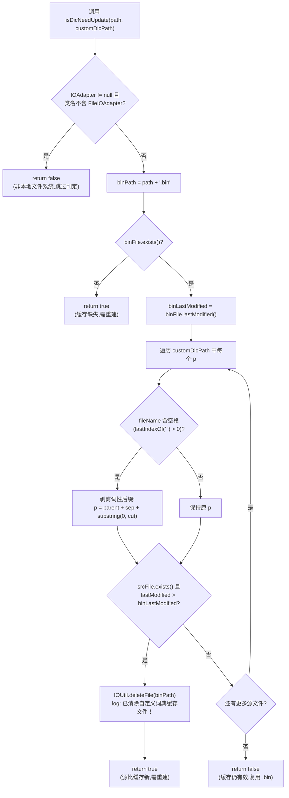

# `DynamicCustomDictionary.isDicNeedUpdate` 方法解析

> 源码位置：
> - 方法本身定义于父类 `com.hankcs.hanlp.dictionary.DynamicCustomDictionary`（HanLP 1.8.4，`hanlp-portable-1.8.4.jar`，**非项目源码树**）。
> - 在项目中的调用点：`headless/chat/src/main/java/com/tencent/supersonic/headless/chat/knowledge/MultiCustomDictionary.java#loadDat`（约 308 行）。
> - 触发链路：`HanlpHelper.getDynamicCustomDictionary()` → `new MultiCustomDictionary(...)` → `load(...)` → `loadMainDictionary(...)` → `loadDat(...)` → `isDicNeedUpdate(...)`。
>
> 说明：`DynamicCustomDictionary` 的源码未随依赖 jar 提供源码包，本文结论基于对 `DynamicCustomDictionary.class` 的字节码反汇编（`javap -p -c -v`）逐指令还原，并对照 `MultiCustomDictionary` 的调用上下文交叉验证。类文件中的中文常量以 GBK 编码存储，已解码还原。

---

## 一、方法签名与定位

```java
public static boolean isDicNeedUpdate(String path, String[] customDicPath)
```

| 参数 | 含义 | 在 SuperSonic 调用处的实参 |
|------|------|----------------------------|
| `path` | 词典主路径（**缓存 `.bin` 文件以 `path + ".bin"` 派生**） | `MultiCustomDictionary.loadDat` 传入的 `path`，即 `HanLP.Config.CustomDictionaryPath[0]` |
| `customDicPath` | 源词典文件路径数组（`.txt` / `.csv`） | `HanLP.Config.CustomDictionaryPath`（或其重写后的本地绝对路径） |
| 返回值 | `true` = 缓存已过期、**需要重建**；`false` = 缓存仍有效、**可直接复用 `.bin`** | — |

该方法是一个**纯静态的「缓存新鲜度判定」工具方法**，不修改词典内存结构，仅可能副作用地删除过期的 `.bin` 缓存文件。

---

## 二、功能概述

`DynamicCustomDictionary` 在加载自定义词典时存在两种数据来源：

1. **预编译的 `.bin` 缓存**（`DoubleArrayTrie` 序列化二进制，加载快）；
2. **原始 `.txt` / `.csv` 文本词典**（需解析 + 构建 `DoubleArrayTrie`，加载慢）。

`isDicNeedUpdate` 的职责是：**在决定是否走「快速 `.bin` 加载」分支之前，判断缓存是否仍然新鲜**。判定策略是基于文件修改时间（`lastModified`）的「**源文件是否比缓存新**」比较：

- 若任一源词典文件比 `.bin` 缓存新（或 `.bin` 不存在） → 返回 `true`，并顺手删除过期 `.bin`，迫使后续流程走「重新解析文本 + 重建 DAT + 重新缓存」的慢路径。
- 若所有源文件都不新于 `.bin` → 返回 `false`，后续直接 `ByteArray.createByteArray(path + ".bin")` 加载缓存。

它在 `MultiCustomDictionary.loadDat` 中的调用形态（项目源码 304–309 行）：

```java
public static boolean loadDat(String path, String[] customDicPath,
        DoubleArrayTrie<CoreDictionary.Attribute> dat) {
    try {
        if (HanLP.Config.CustomDictionaryAutoRefreshCache
                && DynamicCustomDictionary.isDicNeedUpdate(path, customDicPath)) {
            return false;   // 缓存过期 → loadDat 直接返回 false，交由上层走文本重建分支
        } else {
            // ... 读取 path + ".bin" 并填充 dat ...
        }
    }
}
```

> 注意双重门槛：只有当 `HanLP.Config.CustomDictionaryAutoRefreshCache == true` **且** `isDicNeedUpdate == true` 时，才会放弃缓存。关闭自动刷新配置时，本方法不会被调用，`.bin` 一律复用。

---

## 三、逐段实现详解（字节码还原）

以下等价 Java 源码依据 `javap` 反汇编结果逐指令还原，行号注释对应 `DynamicCustomDictionary.class` 中 `isDicNeedUpdate` 的字节码偏移。

### 3.1 前置门槛：IOAdapter 类型守卫

```java
// bytecode offset 0 ~ 24
if (HanLP.Config.IOAdapter != null
        && !HanLP.Config.IOAdapter.getClass().getName()
                .contains("com.hankcs.hanlp.corpus.io.FileIOAdapter")) {
    return false;   // 非本地文件 IOAdapter → 不做新鲜度判定，直接复用缓存
}
```

**语义**：仅当 `IOAdapter` 为 `null`（HanLP 默认 `FileIOAdapter` 行为）或其类名包含 `com.hankcs.hanlp.corpus.io.FileIOAdapter`（即本地文件系统适配器）时，才继续做基于 `File.lastModified()` 的比较；否则立即返回 `false`。

**原因**：后续判定依赖 `java.io.File.exists()` / `lastModified()`，这只能反映本地文件系统元数据。对于自定义 `IIOAdapter`（如读 jar 内资源、HDFS、内存等），`File` 视图不成立，时间戳比较无意义，故直接跳过。

### 3.2 缓存不存在 → 需要更新

```java
// offset 25 ~ 62
String binPath = path + ".bin";            // 拼接缓存文件路径
File binFile = new File(binPath);
if (!binFile.exists()) {
    return true;                            // 缓存缺失，必须重建
}
long binLastModified = binFile.lastModified();
```

**语义**：`.bin` 缓存文件不存在时直接判定「需要更新」（返回 `true`），无需与源文件比较。这是冷启动 / 首次加载的典型路径。

### 3.3 遍历源词典，逐个比较修改时间

```java
// offset 69 ~ 215
for (String p : customDicPath) {
    File file = new File(p);
    String fileName = file.getName();
    int cut = fileName.lastIndexOf(' ');    // offset 114: bipush 32 (空格)
    if (cut > 0) {
        // 文件名形如 "CustomDictionary.txt 词性名"：空格后是默认词性后缀
        // 截掉后缀，取真实文件路径参与时间戳比较
        p = file.getParent() + File.separator + fileName.substring(0, cut);
    }
    File srcFile = new File(p);
    if (srcFile.exists()
            && srcFile.lastModified() > binLastModified) {   // 源比缓存新
        IOUtil.deleteFile(binPath);                          // 删除过期缓存（副作用）
        Predefine.logger.info("已清除自定义词典缓存文件！");    // ldc #153，GBK 解码还原
        return true;                                         // 任一源更新即判定需要重建
    }
}
return false;   // 全部源都不新于缓存 → 缓存有效
```

**关键细节**：

1. **空格后缀剥离**：`fileName.lastIndexOf(' ')`（字面量 `32` 即空格）> 0 时，认为文件名遵循 HanLP 自定义词典的「`<文件名> <默认词性>`」命名约定（如 `CustomDictionary.txt nature`）。比较时间戳时使用剥离词性后缀的真实路径，与 `loadMainDictionary` 中解析默认词性的逻辑保持一致。
2. **比较算子是严格大于 `>`**：源文件 `lastModified` **严格大于** `.bin` 的 `lastModified` 才触发更新。相等视为无需更新（避免同时间戳抖动导致的重复重建）。
3. **短路语义**：只要发现**任意一个**源文件比缓存新，立即删除缓存、返回 `true`，不再检查剩余文件。
4. **副作用**：判定为「需要更新」时会**主动删除 `.bin` 文件**（`IOUtil.deleteFile(binPath)`）。这意味着即便上层因某种原因未完成重建，缓存也已被清除，下次加载会重新走文本解析路径。
5. **日志**：使用 HanLP 内部 `Predefine.logger` 输出 `已清除自定义词典缓存文件！`（原 class 中以 GBK 编码存储，控制台直接 `javap` 会显示乱码）。

---

## 四、还原后的完整源码

```java
public static boolean isDicNeedUpdate(String path, String[] customDicPath) {
    // 1. 仅对本地文件 IOAdapter 生效；自定义 IOAdapter 直接跳过判定
    if (HanLP.Config.IOAdapter != null
            && !HanLP.Config.IOAdapter.getClass().getName()
                    .contains("com.hankcs.hanlp.corpus.io.FileIOAdapter")) {
        return false;
    }
    // 2. 缓存文件路径与存在性
    String binPath = path + ".bin";
    File binFile = new File(binPath);
    if (!binFile.exists()) {
        return true;                 // 缓存缺失 → 需要重建
    }
    long binLastModified = binFile.lastModified();
    // 3. 逐个源文件比较修改时间
    for (String p : customDicPath) {
        File file = new File(p);
        String fileName = file.getName();
        int cut = fileName.lastIndexOf(' ');
        if (cut > 0) {
            // 剥离 "文件名 默认词性" 中的词性后缀
            p = file.getParent() + File.separator + fileName.substring(0, cut);
        }
        File srcFile = new File(p);
        if (srcFile.exists() && srcFile.lastModified() > binLastModified) {
            IOUtil.deleteFile(binPath);                      // 清除过期缓存
            Predefine.logger.info("已清除自定义词典缓存文件！");
            return true;
        }
    }
    return false;                    // 所有源均不新于缓存 → 复用缓存
}
```

---

## 五、判定流程图



---

## 六、在 SuperSonic 中的实际行为

`MultiCustomDictionary.loadDat` 调用 `isDicNeedUpdate` 时，受 `HanLP.Config.CustomDictionaryAutoRefreshCache` 与 `IOAdapter` 两项配置共同制约。SuperSonic 存在两种部署形态，二者行为差异显著：

### 6.1 本地文件模式（默认 / standalone）

`HanlpHelper.resetHanlpConfig()` 未设置 `IOAdapter`（`HanLP.Config.IOAdapter` 默认为 `FileIOAdapter`，类名命中 `contains("FileIOAdapter")`），`isDicNeedUpdate` 走完整判定：

- 词典 `.txt` 被重新生成（如 `FileHelper.resetCustomPath` 重写源文件）后，其 `lastModified` 晚于 `.bin` → 判定需要更新 → 删除 `.bin` → 重新解析文本并重建 DAT。
- 这正是 `HanlpHelper.reloadCustomDictionary()` 走 `FileHelper.deleteCacheFile` + `resetCustomPath` + `reload()` 后能感知到「源已更新」的底层机制之一。

### 6.2 HDFS 模式（`HadoopFileIOAdapter`）

`HadoopFileIOAdapter implements IIOAdapter`（**注意：直接实现 `IIOAdapter`，不继承 `FileIOAdapter`**），其全限定类名为 `com.tencent.supersonic.headless.chat.knowledge.HadoopFileIOAdapter`，**不包含** `com.hankcs.hanlp.corpus.io.FileIOAdapter` 子串。

因此 `isDicNeedUpdate` 在 **3.1 前置门槛处即返回 `false`**，**不会执行任何时间戳比较**。这意味着：

- HDFS 模式下 `loadDat` 永远不会因为「源比缓存新」而放弃 `.bin` 缓存；
- 缓存的新鲜度完全由 `HanlpHelper.reloadCustomDictionary()` 在 HDFS 侧主动管理：`HdfsFileHelper.deleteCacheFile(...)` 显式删除 `.bin`，再 `reload()` 重建。
- 即：HDFS 模式把「过期判定」职责从 HanLP 内建的时间戳比较转移到了 SuperSonic 自身的 `HdfsFileHelper` 流程。

> ⚠️ 实践含义：若在 HDFS 模式下仅替换了 HDFS 上的源 `.txt` 而未调用 `reloadCustomDictionary()`（即未走 `HdfsFileHelper.deleteCacheFile`），`isDicNeedUpdate` 不会感知到变化，`loadDat` 仍会复用旧 `.bin`，导致词典更新不生效。

---

## 七、设计要点与注意事项

| 维度 | 说明 |
|------|------|
| **判定依据** | 纯粹基于 `java.io.File.lastModified()` 的时间戳比较，不校验内容哈希。精度受文件系统时间戳粒度限制。 |
| **比较算子** | 严格大于 `>`，相等不触发更新（避免同一秒内重复重建）。 |
| **短路返回** | 任一源文件更新即返回 `true`，遍历是短路的。 |
| **副作用** | 判定需要更新时会删除 `.bin`；这是「写」操作，但仅作用于缓存文件，安全可重建。 |
| **IOAdapter 守卫** | 仅对本地文件系统生效；自定义 `IIOAdapter` 一律返回 `false`，把新鲜度管理责任下放给调用方。 |
| **配置门槛** | 受 `HanLP.Config.CustomDictionaryAutoRefreshCache` 开关包裹；关闭时本方法不被调用。 |
| **空格后缀约定** | 处理 HanLP 「`文件名 默认词性`」命名约定，与 `loadMainDictionary` 中 `fileName.substring(cut + 1)` 解析词性的逻辑对称（一个取前半做路径，一个取后半做词性）。 |
| **日志归属** | 使用 HanLP 内部 `Predefine.logger`，非 SuperSonic 的 SLF4J 日志；排查时需在 HanLP 的日志通道中查找 `已清除自定义词典缓存文件！`。 |
| **线程安全** | 静态方法、无共享可变状态（仅读 `HanLP.Config.IOAdapter` 全局配置与文件系统），本身线程安全；但并发触发可能多次删除/重建 `.bin`，实际重建由上层 `loadMainDictionary` 的同步语义保障。 |

---

## 八、相关源码索引

- `headless/chat/src/main/java/com/tencent/supersonic/headless/chat/knowledge/MultiCustomDictionary.java`
  - `loadDat(String, String[], DoubleArrayTrie)` — 调用 `isDicNeedUpdate` 的唯一项目内位置（约 304–309 行）。
  - `loadMainDictionary(...)` — `loadDat` 返回 `false` 后接管的文本解析 + DAT 重建 + `.bin` 重缓存路径。
  - `reload()` — `reloadCustomDictionary()` 的底层入口，删除 `.bin` 后重走 `loadDat` / `loadMainDictionary`。
- `headless/chat/src/main/java/com/tencent/supersonic/headless/chat/knowledge/helper/HanlpHelper.java`
  - `getDynamicCustomDictionary()` — 实例化 `MultiCustomDictionary`。
  - `reloadCustomDictionary()` — 区分 `HadoopFileIOAdapter` / 本地模式，分别走 `HdfsFileHelper` / `FileHelper` 清理缓存。
- `headless/chat/src/main/java/com/tencent/supersonic/headless/chat/knowledge/HadoopFileIOAdapter.java`
  - 直接 `implements IIOAdapter`，非 `FileIOAdapter` 子类 → 触发 `isDicNeedUpdate` 的前置守卫短路。
- `headless/chat/src/main/java/com/tencent/supersonic/headless/chat/knowledge/helper/FileHelper.java` / `HdfsFileHelper.java`
  - 两种部署形态下的缓存文件清理实现。
- 父类依赖：`com.hankcs.hanlp.dictionary.DynamicCustomDictionary`（`hanlp-portable-1.8.4.jar`）。
