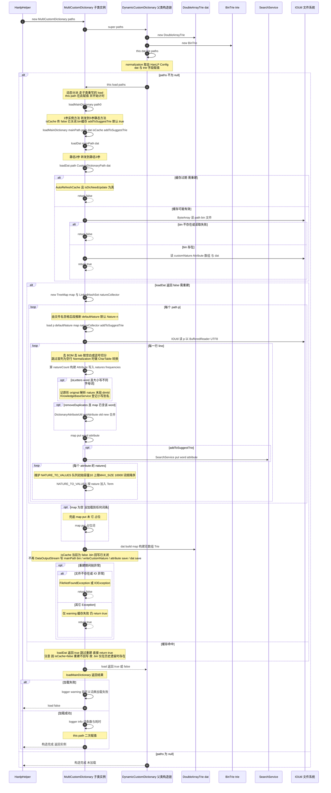

# `MultiCustomDictionary(String... paths)` 构造调用时序图

> 源码：
> - `headless/chat/src/main/java/com/tencent/supersonic/headless/chat/knowledge/MultiCustomDictionary.java`
> - 父类：`com.hankcs.hanlp.dictionary.DynamicCustomDictionary`（HanLP 1.8.4）
> - 触发入口：`headless/chat/src/main/java/.../knowledge/helper/HanlpHelper.java#getDynamicCustomDictionary()`
>
> 说明：本文时序描述 **构造函数 `MultiCustomDictionary(String... paths)` 被调用后，直至词典加载完成** 期间各级方法的调用关系。`MultiCustomDictionary` 通过方法重写/静态遮蔽（shadow）接管了父类的加载流程。
>
> ⚠️ **重要变更**：当前版本已**关闭 `.bin` 缓存回写**——`loadMainDictionary(String)` 与 `reload()` 均传 `isCache=false`（原为 `true`）。`loadDat` 仍尝试读取已有 `.bin`，但重建后不再生成/刷新 `.bin`；`reload()` 还会先删除 `.bin` 再重建。详见阶段 3、阶段 4 及第六节。

---

## 一、参与对象

| 简称 | 实际对象 | 角色 |
|------|----------|------|
| **Caller** | `HanlpHelper.getDynamicCustomDictionary()` | 外部触发者，`new MultiCustomDictionary(HanLP.Config.CustomDictionaryPath)` |
| **MCD** | `MultiCustomDictionary` 子类实例 | 构造体 + 重写的 `load` / `loadMainDictionary` / `loadDat` / 静态 `load` 解析器 |
| **DCD** | `DynamicCustomDictionary`（父类） | 构造链 `super(paths)` → `this(dat,trie,paths)` → 触发 `load` |
| **DAT** | `DoubleArrayTrie<Attribute>` | 双数组 Trie，主词典索引 |
| **BinTrie** | `BinTrie<Attribute>` | 增量插入用 Trie（运行时 `insert` 落点） |
| **SearchService** | `SearchService` | 前缀/后缀匹配 Trie（`addToSuggestTrie=true` 时填充） |
| **FS/IO** | `IOUtil` / `ByteArray` / 文件系统 | 读取 `.txt` 与 `.bin` 缓存 |

---

## 二、整体时序图（Mermaid）



---

## 三、分阶段文字说明

### 阶段 0 ｜ 构造链 `super(paths)`

`MultiCustomDictionary(String... paths)` 仅一行 `super(paths)`，进入父类 `DynamicCustomDictionary(String...)`：

1. `new DoubleArrayTrie<>()` → `dat`
2. `new BinTrie<>()` → `trie`
3. 调 3 参构造 `this(dat, trie, paths)`：
   - `normalization = HanLP.Config.Normalization`
   - `this.dat = dat`；`this.trie = trie`
   - **若 `paths != null`，调用 `this.load(paths)`**

> 关键：`load` 是实例方法，Java 动态分派 → 实际执行**子类重写的** `MultiCustomDictionary.load`。这是子类接管加载流程的入口。

### 阶段 1 ｜ `MultiCustomDictionary.load(String... paths)`（重写）

- 记录 `this.path = paths`、计时；
- 调 `this.loadMainDictionary(paths[0])`（1 参实例方法）；
- 据返回值打日志：成功输出词条数与耗时，失败输出 warning。

### 阶段 2 ｜ `loadMainDictionary(mainPath)` → 静态 `loadMainDictionary(...)`

1 参实例方法转发到 5 参静态方法：

```
loadMainDictionary(mainPath, this.path, this.dat, isCache=false, addToSuggestTrie)
```

> ⚠️ `isCache` 当前传 **`false`**（注释「关闭 .bin 缓存」），原为 `true`。`reload()` 内部对静态 `loadMainDictionary` 的调用同样传 `false`。这使重建后不再回写 `.bin`。

静态方法先尝试缓存（阶段 3），失败则文本重建（阶段 4）。

### 阶段 3 ｜ 第一关：加载 `.bin` 缓存

调用链：`loadDat(mainPath, dat)` → `loadDat(path, CustomDictionaryPath, dat)`。

- 若 `CustomDictionaryAutoRefreshCache && isDicNeedUpdate(path, customDicPath)` → 返回 `false`（缓存过期，会删除 `.bin`）；
- 否则 `ByteArray.createByteArray(path + ".bin")`：
  - 为空 → 返回 `false`；
  - 不为空 → 读取 `customNature`、`Attribute[]`（填充 `natures`/`frequencies`）、`dat.load(byteArray, attributes)` → 返回 `true`。

**`loadDat == true` ⇒ `loadMainDictionary` 直接返回 true，跳过文本解析。**

> ⚠️ 缓存策略变更影响：由于阶段 4 重建不再回写 `.bin`（`isCache=false`），`.bin` 仅在以下情况存在并被命中：①历史遗留的 `.bin`（升级前生成且未过期）；②手工放置的 `.bin`。`reload()` 会先 `IOUtil.deleteFile` 删除 `.bin`，因此热重载后 `.bin` 不复存在，后续每次加载都从 `.txt` 重建。

### 阶段 4 ｜ 第二关：`.txt` 文本重建（`loadDat == false` 时）

1. 新建 `TreeMap<String, Attribute> map` 与 `LinkedHashSet<Nature> customNatureCollector`；
2. **遍历每个 path `p`**：
   - 由文件名空格推断 `defaultNature`（无则 `Nature.n`）；
   - 调静态 `load(p, defaultNature, map, customNatureCollector, addToSuggestTrie)`（逐行解析器，见阶段 5）；
3. `dat.build(map)` 构建双数组 Trie；
4. `isCache == false`（当前已关闭）：**不序列化** `mainPath + ".bin"`，重建结果仅驻留内存。原 `isCache==true` 时的回写逻辑（`IOUtil.writeCustomNature` → 写 `Attribute` 列表 → `dat.save(out)` → `close`）仍存在于静态方法代码中，但因入参为 `false` 不再触发。

### 阶段 5 ｜ 静态 `load(path, defaultNature, map, …)` 逐行解析器

对文件每一行：

1. `IOUtil.removeUTF8BOM`（首行）→ 去 `\t` → 按 `\s`（`.txt`）或 `,`（`.csv`）切分 → 跳过首列为空行；
2. `Normalization` 开启时 `CharTable.convert(param[0])`；
3. `natureCount = (param.length - 1) / 2`，按 `nature freq` 两两分组构建 `Attribute`（写入 `attribute.natures[i]` / `attribute.frequencies[i]` / `attribute.originals[i]`，累加 `attribute.totalFrequency`）；
4. **字母词分支**（`isLetters(word)` 且大小写不同）：记 `original`、解析 nature 末段 `dimId`、`KnowledgeBaseService.addDimValueAlias(dimId, 小写别名)`；末段非数字会抛 `NumberFormatException` → 走 `return true` 中止后续解析；
5. **去重合并**：`removeDuplicates && map.containsKey(word)` → `DictionaryAttributeUtil.getAttribute(old, new)`；
6. `map.put(word, attribute)`；
7. `addToSuggestTrie == true` → `SearchService.put(word, attribute)`；
8. 遍历 `attribute.natures`，维护 `NATURE_TO_VALUES`：每个 nature 一个按词频降序的 `PriorityBlockingQueue<Term>`——队列**初始容量 `10`**（构造参数硬编码），**保留上限 `MAX_SIZE=10000`**（`priorityQueue.size() < MAX_SIZE` 判定，原为 `10`）。

### 阶段 6 ｜ 收尾

- `loadMainDictionary` 返回值 → `load` 据此打日志并返回；
- 构造完成，实例交还 `HanlpHelper`，存入静态字段 `CustomDictionary`，供 `getSegment()` 经 `enableCustomDictionary(...)` 启用。

---

## 四、方法调用总览（栈帧视角）

```
new MultiCustomDictionary(paths)
└─ super(paths)                                     // DynamicCustomDictionary(String...)
   ├─ new DoubleArrayTrie()                         // dat
   ├─ new BinTrie()                                 // trie
   └─ this(dat, trie, paths)                        // DynamicCustomDictionary(DAT,BinTrie,String[])
      ├─ normalization = HanLP.Config.Normalization
      ├─ this.dat = dat ; this.trie = trie
      └─ this.load(paths)  ──动态分派──▶  MultiCustomDictionary.load(String...)   【重写】
         ├─ this.path = paths
         ├─ this.loadMainDictionary(paths[0])       // 实例(1参)
         │  └─ loadMainDictionary(mainPath, this.path, dat, false, addToSuggestTrie)  【静态】  // isCache=false 关闭.bin缓存
         │     ├─ loadDat(mainPath, dat)            // 静态(2参) 【遮蔽父类】
         │     │  └─ loadDat(path, CustomDictionaryPath, dat)  // 静态(3参) 【遮蔽父类】
         │     │     ├─ (缓存过期?) isDicNeedUpdate → false
         │     │     ├─ ByteArray.createByteArray(path+".bin")
         │     │     │  ├─ null → false
         │     │     │  └─ 读 nature/Attribute[](natures/frequencies)/dat.load → true
         │     │     └─ return
         │     ├─ [loadDat==false] 重建:
         │     │  ├─ new TreeMap<> map ; new LinkedHashSet<> customNatureCollector
         │     │  ├─ for p in path:
         │     │  │    └─ load(p, defaultNature, map, customNatureCollector, addToSuggestTrie)  【静态,遮蔽父类】
         │     │  │       ├─ IOUtil.newInputStream(p) / BufferedReader
         │     │  │       ├─ for each line: 解析→Attribute(natures/frequencies)→(合并)→map.put
         │     │  │       │    ├─ [字母词] KnowledgeBaseService.addDimValueAlias
         │     │  │       │    ├─ [addToSuggestTrie] SearchService.put
         │     │  │       │    └─ NATURE_TO_VALUES 维护 (上限 MAX_SIZE=10000)
         │     │  ├─ dat.build(map)
         │     │  └─ [isCache=false] 跳过 .bin 回写 (原 writeCustomNature/attribute save/dat.save 不触发)
         │     └─ return true
         └─ logger.info/warning ; this.path = paths ; return
```

---

## 五、重写/遮蔽关系一览

| 父类 `DynamicCustomDictionary` 成员 | `MultiCustomDictionary` 处理 | 影响 |
|--------------------------------------|------------------------------|------|
| `load(String...)`（实例） | **重写** | 构造期 `this.load` 走子类逻辑 |
| `loadMainDictionary(String,boolean)`（实例） | 新增 `loadMainDictionary(String)`（1 参） | 子类自有转发路径 |
| `loadMainDictionary(...)`（静态） | **静态遮蔽**（同名同参静态） | 调用解析为子类静态版 |
| `loadDat(String,DAT)` / `loadDat(String,String[],DAT)`（静态） | **静态遮蔽** | 缓存读取走子类版 |
| `load(String,Nature,TreeMap,…)`（静态逐行解析器） | **静态遮蔽** | 文本解析走子类版（含 `NATURE_TO_VALUES`、`SearchService`、`addDimValueAlias`） |

> 静态方法不存在动态分派，“遮蔽”发生在**编译期按引用类型静态绑定**。由于 `loadMainDictionary` 静态版内部对 `loadDat` / `load` 的调用均在 `MultiCustomDictionary` 代码内书写，故全部绑定到子类静态版——这正是子类能接管整条加载链的原因。

---

## 六、关键判定与副作用

| 判定/副作用 | 位置 | 结果 |
|-------------|------|------|
| `paths == null` | 父类 3 参构造 | 不触发 `load`，构造空词典 |
| `.bin` 存在且未过期 | `loadDat(3参)` | 缓存命中，**跳过文本解析**（仅历史遗留 `.bin` 可命中） |
| `.bin` 不存在/过期 | `loadDat(3参)` 返回 false | 走 `.txt` 重建；**因 `isCache=false` 不回写 `.bin`** |
| `isLetters(word)` && 大小写不同 && nature 末段为数字 | 静态 `load` 字母词分支 | `addDimValueAlias` 成功 |
| `isLetters(word)` && nature 末段非数字 | 静态 `load` 字母词分支 | `NumberFormatException` → `return true`，**中止后续解析** |
| `#` 注释行（多 token） | 静态 `load` 词频解析 | `Integer.parseInt` 抛异常 → `return false`，**整文件加载失败** |
| `removeDuplicates == true` | 静态 `load` | 同词多 nature 经 `DictionaryAttributeUtil` 合并 |
| `addToSuggestTrie == true`（默认） | 静态 `load` | 同步填充 `SearchService` 前缀 Trie |
| `isCache == false`（当前已关闭） | `loadMainDictionary(String)` / `reload()` | 重建后**不回写** `.bin`；`loadDat` 仍尝试读取已有 `.bin` |
| `MAX_SIZE == 10000`（原为 10） | 静态 `load` 的 `NATURE_TO_VALUES` | 每个 nature 队列保留上限 10000 条（队列初始容量仍为 10） |

---

## 附：入口与复用

- **唯一构造入口**：`HanlpHelper.getDynamicCustomDictionary()` → `new MultiCustomDictionary(HanLP.Config.CustomDictionaryPath)`（双重检查锁单例）。
- **运行时增量插入**（不走构造/文件）：`MultiCustomDictionary.insert(word, natureWithFrequency)` → `dat.set` 或 `trie.put`，并 `SearchService.put`。
- **热重载**：`HanlpHelper.reloadCustomDictionary()` → `reload()` → 删 `.bin` → `loadDat`（必失败）→ `loadMainDictionary(..., isCache=false, ...)` 重跑（**不回写 `.bin`**）。
- **`.bin` 缓存现状**：当前版本 `isCache=false`，重建不生成 `.bin`；`loadDat` 仅能命中历史遗留的 `.bin`。如需恢复缓存加速，可将 `loadMainDictionary(String)` 与 `reload()` 中的 `isCache` 改回 `true`。
