# `MultiCustomDictionary(String... path)` 构造调用时序图

> 源码：
> - `headless/chat/src/main/java/com/tencent/supersonic/headless/chat/knowledge/MultiCustomDictionary.java`
> - 父类：`com.hankcs.hanlp.dictionary.DynamicCustomDictionary`（HanLP 1.8.4）
> - 触发入口：`headless/chat/src/main/java/.../knowledge/helper/HanlpHelper.java#getDynamicCustomDictionary()`
>
> 说明：本文时序描述 **构造函数 `MultiCustomDictionary(String... path)` 被调用后，直至词典加载完成** 期间各级方法的调用关系。`MultiCustomDictionary` 通过方法重写/静态遮蔽（shadow）接管了父类的加载流程。

---

## 一、参与对象

| 简称 | 实际对象 | 角色 |
|------|----------|------|
| **Caller** | `HanlpHelper.getDynamicCustomDictionary()` | 外部触发者，`new MultiCustomDictionary(HanLP.Config.CustomDictionaryPath)` |
| **MCD** | `MultiCustomDictionary` 子类实例 | 构造体 + 重写的 `load` / `loadMainDictionary` / `loadDat` / 静态 `load` 解析器 |
| **DCD** | `DynamicCustomDictionary`（父类） | 构造链 `super(path)` → `this(dat,trie,path)` → 触发 `load` |
| **DAT** | `DoubleArrayTrie<Attribute>` | 双数组 Trie，主词典索引 |
| **BinTrie** | `BinTrie<Attribute>` | 增量插入用 Trie（运行时 `insert` 落点） |
| **SearchService** | `SearchService` | 前缀/后缀匹配 Trie（`addToSuggesterTrie=true` 时填充） |
| **FS/IO** | `IOUtil` / `ByteArray` / 文件系统 | 读取 `.txt` 与 `.bin` 缓存 |

---

## 二、整体时序图（Mermaid）

```mermaid
sequenceDiagram
    autonumber
    participant Caller as HanlpHelper
    participant MCD as MultiCustomDictionary 子类实例
    participant DCD as DynamicCustomDictionary 父类构造链
    participant DAT as DoubleArrayTrie dat
    participant BinTrie as BinTrie trie
    participant SS as SearchService
    participant FS as IOUtil 文件系统

    Caller->>MCD: new MultiCustomDictionary path
    MCD->>DCD: super path
    DCD->>DAT: new DoubleArrayTrie
    DCD->>BinTrie: new BinTrie
    DCD->>DCD: this dat trie path
    Note over DCD: normalization 取自 HanLP Config<br/>dat 与 trie 字段赋值
    alt path 不为 null
        DCD->>MCD: this load path
        Note over MCD: 动态分派 走子类重写的 load<br/>this path 在此赋值 并开始计时

        %% 第一关 尝试加载 bin 缓存
        MCD->>MCD: loadMainDictionary path0
        Note over MCD: 1参实例方法 转发到5参静态方法<br/>isCache 传 true addToSuggesterTrie 默认 true
        MCD->>MCD: loadMainDictionary mainPath path dat isCache addToSuggesterTrie
        MCD->>MCD: loadDat mainPath dat
        Note over MCD: 静态2参 转发到静态3参
        MCD->>MCD: loadDat path CustomDictionaryPath dat

        alt 缓存过期 需重建
            Note over MCD: AutoRefreshCache 且 isDicNeedUpdate 为真
            MCD-->>MCD: return false
        else 缓存可能有效
            MCD->>FS: ByteArray 读 path bin 文件
            alt bin 不存在或读取失败
                MCD-->>MCD: return false
            else bin 存在
                MCD->>FS: 读 customNature Attribute 数组 与 dat
                MCD-->>MCD: return true
            end
        end

        %% 第二关 缓存未命中 解析 txt 重建
        alt loadDat 返回 false 需重建
            MCD->>MCD: new TreeMap map 与 LinkedHashSet natureCollector
            loop 每个 path p
                Note over MCD: 由文件名空格后段推断 defaultNature 默认 Nature n
                MCD->>MCD: load p defaultNature map natureCollector addToSuggesterTrie
                %% 静态 load 逐行解析器
                MCD->>FS: IOUtil 读 p 以 BufferedReader UTF8
                loop 每一行 line
                    Note over MCD: 去 BOM 去 tab 按空白或逗号切分<br/>跳过首列为空行 Normalization 时做 CharTable 转换
                    MCD->>MCD: 算 natureCount 构建 Attribute
                    opt isLetters word 且大小写不同 字母词
                        Note over MCD: 记原形 original 解析 nature 末段 dimId<br/>KnowledgeBaseService 登记小写别名
                    end
                    opt removeDuplicates 且 map 已含该 word
                        MCD->>MCD: DictionaryAttributeUtil getAttribute old new 合并
                    end
                    MCD->>MCD: map put word attribute
                    opt addToSuggesterTrie
                        MCD->>SS: SearchService put word attribute
                    end
                    loop 每个 attribute 的 nature
                        Note over MCD: 维护 NATURE_TO_VALUES 容量 10 词频降序
                        MCD->>MCD: NATURE_TO_VALUES 按 nature 加入 Term
                    end
                end
            end

            opt map 为空 没加载到任何词条
                Note over MCD: 兜底 map put 未 它 占位
                MCD->>MCD: map put 占位词
            end

            MCD->>DAT: dat build map 构建双数组 Trie
            opt isCache 为 true
                Note over MCD: 缓存为 dat 文件
                MCD->>FS: DataOutputStream 写 mainPath bin
                opt natureCollector 为空
                    Note over MCD: 遍历 Nature values 全量补入 collector
                end
                MCD->>FS: IOUtil writeCustomNature natureCollector
                MCD->>FS: 逐个 attribute save out
                MCD->>DAT: dat save out
                MCD->>FS: out close
            end

            opt 重建期间抛异常
                alt 文件不存在或 IO 异常
                    Note over MCD: FileNotFoundException 或 IOException
                    MCD-->>MCD: return false
                else 其它 Exception
                    Note over MCD: 仅 warning 缓存失败 仍 return true
                    MCD-->>MCD: return true
                end
            end
        else 缓存命中
            Note over MCD: loadDat 返回 true 跳过重建 直接 return true
        end

        %% 收尾
        MCD-->>DCD: load 返回 true 或 false
        Note over MCD: loadMainDictionary 返回结果
        alt 加载失败
            MCD->>MCD: logger warning 自定义词典加载失败
            MCD-->>Caller: load false
        else 加载成功
            MCD->>MCD: logger info 词条数与耗时
            Note over MCD: this path 二次赋值
            MCD-->>Caller: 构造完成 返回实例
        end
    else path 为 null
        DCD-->>Caller: 构造完成 未加载
    end
```



---

## 三、分阶段文字说明

### 阶段 0 ｜ 构造链 `super(path)`

`MultiCustomDictionary(String... path)` 仅一行 `super(path)`，进入父类 `DynamicCustomDictionary(String...)`：

1. `new DoubleArrayTrie<>()` → `dat`
2. `new BinTrie<>()` → `trie`
3. 调 3 参构造 `this(dat, trie, path)`：
   - `normalization = HanLP.Config.Normalization`
   - `this.dat = dat`；`this.trie = trie`
   - **若 `path != null`，调用 `this.load(path)`**

> 关键：`load` 是实例方法，Java 动态分派 → 实际执行**子类重写的** `MultiCustomDictionary.load`。这是子类接管加载流程的入口。

### 阶段 1 ｜ `MultiCustomDictionary.load(String... path)`（重写）

- 记录 `this.path = path`、计时；
- 调 `this.loadMainDictionary(path[0])`（1 参实例方法）；
- 据返回值打日志：成功输出词条数与耗时，失败输出 warning。

### 阶段 2 ｜ `loadMainDictionary(mainPath)` → 静态 `loadMainDictionary(...)`

1 参实例方法转发到 5 参静态方法：

```
loadMainDictionary(mainPath, this.path, this.dat, isCache=true, addToSuggesterTrie)
```

静态方法先尝试缓存（阶段 3），失败则文本重建（阶段 4）。

### 阶段 3 ｜ 第一关：加载 `.bin` 缓存

调用链：`loadDat(mainPath, dat)` → `loadDat(path, CustomDictionaryPath, dat)`。

- 若 `CustomDictionaryAutoRefreshCache && isDicNeedUpdate(path, customDicPath)` → 返回 `false`（缓存过期）；
- 否则 `ByteArray.createByteArray(path + ".bin")`：
  - 为空 → 返回 `false`；
  - 不为空 → 读取 `customNature`、`Attribute[]`、`dat.load(byteArray, attributes)` → 返回 `true`。

**`loadDat == true` ⇒ `loadMainDictionary` 直接返回 true，跳过文本解析。**

### 阶段 4 ｜ 第二关：`.txt` 文本重建（`loadDat == false` 时）

1. 新建 `TreeMap<String, Attribute> map` 与 `LinkedHashSet<Nature> customNatureCollector`；
2. **遍历每个 path `p`**：
   - 由文件名空格推断 `defaultNature`（无则 `Nature.n`）；
   - 调静态 `load(p, defaultNature, map, customNatureCollector, addToSuggesterTrie)`（逐行解析器，见阶段 5）；
3. `dat.build(map)` 构建双数组 Trie；
4. `isCache == true` 时序列化为 `mainPath + ".bin"`：
   `IOUtil.writeCustomNature` → 写 `Attribute` 列表 → `dat.save(out)` → `close`。

### 阶段 5 ｜ 静态 `load(path, defaultNature, map, …)` 逐行解析器

对文件每一行：

1. `IOUtil.removeUTF8BOM`（首行）→ 去 `\t` → 按 `\s`（`.txt`）或 `,`（`.csv`）切分 → 跳过首列为空行；
2. `Normalization` 开启时 `CharTable.convert(param[0])`；
3. `natureCount = (param.length - 1) / 2`，按 `nature freq` 两两分组构建 `Attribute`；
4. **字母词分支**（`isLetters(word)` 且大小写不同）：记 `original`、解析 nature 末段 `dimId`、`KnowledgeBaseService.addDimValueAlias(dimId, 小写别名)`；末段非数字会抛 `NumberFormatException` → 走 `return true` 中止后续解析；
5. **去重合并**：`removeDuplicates && map.containsKey(word)` → `DictionaryAttributeUtil.getAttribute(old, new)`；
6. `map.put(word, attribute)`；
7. `addToSuggesterTrie == true` → `SearchService.put(word, attribute)`；
8. 遍历 `attribute.nature`，维护 `NATURE_TO_VALUES`：每个 nature 一个按词频降序、容量 `MAX_SIZE=10` 的 `PriorityBlockingQueue<Term>`。

### 阶段 6 ｜ 收尾

- `loadMainDictionary` 返回值 → `load` 据此打日志并返回；
- 构造完成，实例交还 `HanlpHelper`，存入静态字段 `CustomDictionary`，供 `getSegment()` 经 `enableCustomDictionary(...)` 启用。

---

## 四、方法调用总览（栈帧视角）

```
new MultiCustomDictionary(path)
└─ super(path)                                      // DynamicCustomDictionary(String...)
   ├─ new DoubleArrayTrie()                         // dat
   ├─ new BinTrie()                                 // trie
   └─ this(dat, trie, path)                         // DynamicCustomDictionary(DAT,BinTrie,String[])
      ├─ normalization = HanLP.Config.Normalization
      ├─ this.dat = dat ; this.trie = trie
      └─ this.load(path)  ──动态分派──▶  MultiCustomDictionary.load(String...)   【重写】
         ├─ this.path = path
         ├─ this.loadMainDictionary(path[0])        // 实例(1参)
         │  └─ loadMainDictionary(mainPath, this.path, dat, true, addToSuggesterTrie)  【静态】
         │     ├─ loadDat(mainPath, dat)            // 静态(2参) 【遮蔽父类】
         │     │  └─ loadDat(path, CustomDictionaryPath, dat)  // 静态(3参) 【遮蔽父类】
         │     │     ├─ (缓存过期?) isDicNeedUpdate → false
         │     │     ├─ ByteArray.createByteArray(path+".bin")
         │     │     │  ├─ null → false
         │     │     │  └─ 读 nature/Attribute[]/dat.load → true
         │     │     └─ return
         │     ├─ [loadDat==false] 重建:
         │     │  ├─ new TreeMap map ; new LinkedHashSet customNatureCollector
         │     │  ├─ for p in path:
         │     │  │    └─ load(p, defaultNature, map, customNatureCollector, addToSuggesterTrie)  【静态,遮蔽父类】
         │     │  │       ├─ IOUtil.newInputStream(p) / BufferedReader
         │     │  │       ├─ for each line: 解析→Attribute→(合并)→map.put
         │     │  │       │    ├─ [字母词] KnowledgeBaseService.addDimValueAlias
         │     │  │       │    ├─ [addToSuggesterTrie] SearchService.put
         │     │  │       │    └─ NATURE_TO_VALUES 维护
         │     │  ├─ dat.build(map)
         │     │  └─ [isCache] 序列化 mainPath+".bin"
         │     └─ return true
         └─ logger.info/warning ; this.path = path ; return
```

---

## 五、重写/遮蔽关系一览

| 父类 `DynamicCustomDictionary` 成员 | `MultiCustomDictionary` 处理 | 影响 |
|--------------------------------------|------------------------------|------|
| `load(String...)`（实例） | **重写** | 构造期 `this.load` 走子类逻辑 |
| `loadMainDictionary(String,boolean)`（实例） | 新增 `loadMainDictionary(String)`（1 参） | 子类自有转发路径 |
| `loadMainDictionary(...)`（静态） | **静态遮蔽**（同名同参静态） | 调用解析为子类静态版 |
| `loadDat(String,DAT)` / `loadDat(String,String[],DAT)`（静态） | **静态遮蔽** | 缓存读取走子类版 |
| `load(String,Nature,TreeMap,…)`（静态逐行解析器） | **静态遮蔽** | 文本解析走子类版（含 `NATURE_TO_VALUES`、`SearchService`、`addDimValueAlias`） |

> 静态方法不存在动态分派，“遮蔽”发生在**编译期按引用类型静态绑定**。由于 `loadMainDictionary` 静态版内部对 `loadDat` / `load` 的调用均在 `MultiCustomDictionary` 代码内书写，故全部绑定到子类静态版——这正是子类能接管整条加载链的原因。

---

## 六、关键判定与副作用

| 判定/副作用 | 位置 | 结果 |
|-------------|------|------|
| `path == null` | 父类 3 参构造 | 不触发 `load`，构造空词典 |
| `.bin` 存在且未过期 | `loadDat(3参)` | 缓存命中，**跳过文本解析** |
| `.bin` 不存在/过期 | `loadDat(3参)` 返回 false | 走 `.txt` 重建并回写 `.bin` |
| `isLetters(word)` && 大小写不同 && nature 末段为数字 | 静态 `load` 字母词分支 | `addDimValueAlias` 成功 |
| `isLetters(word)` && nature 末段非数字 | 静态 `load` 字母词分支 | `NumberFormatException` → `return true`，**中止后续解析** |
| `#` 注释行（多 token） | 静态 `load` 词频解析 | `Integer.parseInt` 抛异常 → `return false`，**整文件加载失败** |
| `removeDuplicates == true` | 静态 `load` | 同词多 nature 经 `DictionaryAttributeUtil` 合并 |
| `addToSuggesterTrie == true`（默认） | 静态 `load` | 同步填充 `SearchService` 前缀 Trie |
| `isCache == true` | `loadMainDictionary` 静态 | 重建后回写 `.bin` 供下次加速 |

---

## 附：入口与复用

- **唯一构造入口**：`HanlpHelper.getDynamicCustomDictionary()` → `new MultiCustomDictionary(HanLP.Config.CustomDictionaryPath)`（双重检查锁单例）。
- **运行时增量插入**（不走构造/文件）：`MultiCustomDictionary.insert(word, natureWithFrequency)` → `dat.set` 或 `trie.put`，并 `SearchService.put`。
- **热重载**：`HanlpHelper.reloadCustomDictionary()` → `reload()` → 删 `.bin` → `loadDat` → 失败则 `loadMainDictionary` 重跑。
